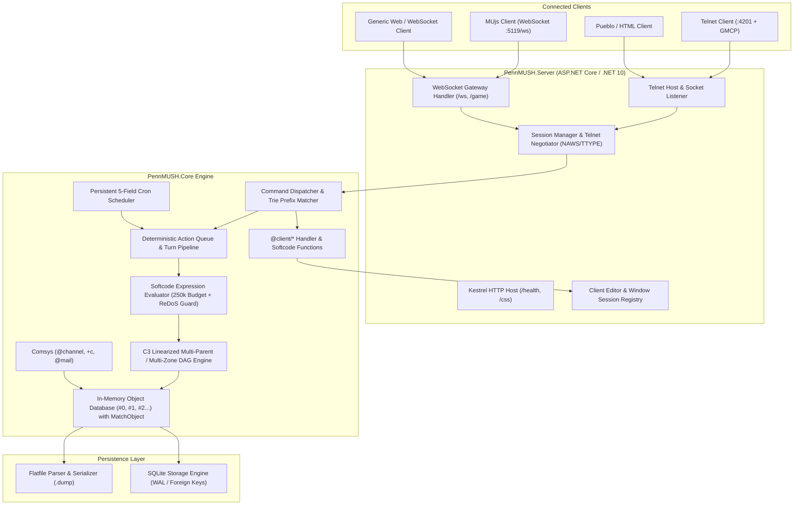

# PennMUSH .NET

A modern, high-performance C# / .NET 10 reimplementation of the **PennMUSH** virtual world engine.

PennMUSH .NET preserves backward compatibility with standard PennMUSH softcode and database flatfiles while replacing legacy single-threaded C constraints with modern asynchronous concurrency, transactional SQLite storage, robust runtime safety guards, and built-in cron scheduling.

---

## 🌟 Key Highlights & Architectural Differences

| Feature | Legacy PennMUSH (C) | PennMUSH .NET (C# 13 / .NET 10) |
| :--- | :--- | :--- |
| **Runtime & Concurrency** | Single-threaded event loop (`select()` / `poll()`) with blocking operations | Fully asynchronous, multi-threaded task pipeline with deterministic command turn slicing |
| **Persistence** | Text `.dump` flatfiles prone to corruption on hard crashes | **Dual persistence:** Transactional SQLite (WAL mode, foreign keys, ACID) alongside PennMUSH `.dump` flatfile parser/serializer |
| **Execution Budget** | 2,500 hard invocation cap (frequently aborts complex softcode) | **250,000 adaptive token budget** with cooperative execution timeouts |
| **Runaway Protection** | Prone to infinite recursion crashes and ReDoS regex freezes | **Active call-trail cycle detection** + **100ms ReDoS timeout** + **queue flood throttle** |
| **Object Inheritance** | Linear search through parents / zones with attribute shadowing quirks | **C3 Linearization (DAG)** for clean multi-parent and multi-zone attribute & lock resolution |
| **Task Scheduling** | Fragile recursive `@wait` loops and external crontab wrappers | **Native 5-field Cron Engine** (`@cron`, `cron_add()`, `cron_list()`) persisted to database |
| **Networking** | Raw Telnet socket with ad-hoc option parsing | **Dual-transport:** Async Telnet listener (`:4201` + GMCP) + Native WebSocket gateway (`:5119/ws`) with typed JSON protocol |
| **Presentation & HTML** | Text-only or legacy Pueblo custom tags | **TELOPT NAWS & TTYPE negotiation**, direct HTML streaming for modern web/Pueblo clients, and TrueColor/256/16-color ANSI fallback |
| **Web Integration** | Requires external web server / CGI | Embedded ASP.NET Core Kestrel server (`:5119`) serving static stylesheets (`/css`), health checks (`/health`), and WebSockets (`/ws`) |
| **Client RPC & Tooling** | Fragile text scraping (`ProgStart >`, `!@Window:`) | **Structured MUjs Protocol (v1.0):** Capability handshake, atomic code editor RPC, dockable panes, dynamic CSS, and signed script execution |

---

## 🏛️ Architecture Overview



---

## 🚀 Key Subsystems

### 1. Softcode Evaluator & Runtime Safety
PennMUSH .NET features a complete MUSHcode expression evaluator supporting ~400 standard softcode functions:
- **Adaptive Execution Budget:** 250,000 execution tokens per invocation (100x legacy limits) without risking runaway CPU usage.
- **Cycle & Recursion Protection:** Active `CallTrail` tracking prevents recursive attribute call loops (`A` calling `B` calling `A`) before stack overflow occurs.
- **ReDoS Guard:** Softcode regular expressions enforce a strict 100ms cancellation timeout.
- **Async Softcode Primitives:** Native support for non-blocking operations via `async()`, `parallel_map()`, and `bgtask()`.

### 2. Multi-Parent & Multi-Zone DAG Resolution
Objects support multiple parents (`@parent obj = #p1 #p2`) and multiple zones (`@chzone obj = #z1 #z2`). 
Attribute, lock, and flag lookups use **C3 Linearization** (the same algorithm used by Python and Dylan for method resolution orders), ensuring:
- Deterministic attribute lookup across complex diamond inheritance graphs.
- Prevention of circular inheritance graphs.
- Clear, predictable attribute inheritance without shadowing bugs.

### 3. Native Cron Scheduling Subsystem
No more fragile `@wait 60 = @trigger me/TICK` loops or external crontab wrappers.
- Implements standard 5-field cron expressions: `minute hour dom month dow`.
- In-game administrative command:
  ```mushcode
  @cron/add DailyBackup=0 4 * * * = @dump
  @cron/list
  @cron/delete DailyBackup
  ```
- Softcode functions: `cron_list()`, `cron_add()`, `cron_del()`, `cron_info()`.
- Schedules are durable and saved directly into the database.

### 4. Dual Persistence Layer
- **Flatfile Store:** Imports and exports legacy PennMUSH database files (`mush.dump`), maintaining full compatibility with existing archives and worlds.
- **SQLite Store:** Modern transactional persistence utilizing SQLite in WAL mode with relational tables for objects, attributes, locks, channels, mail, and cron jobs.

### 5. Modern Presentation & Networking
- **Telnet Negotiation:** Full support for `TELOPT_NAWS` (client window resizing) and `TELOPT_TTYPE` (terminal capabilities detection).
- **Rich HTML & Pueblo Support:** Direct raw HTML tags can be streamed to clients reporting Pueblo capability or connected via WebSockets.
- **Color Translation:** Rich HTML colors (`<span style="color: #55ff55">`) automatically translate to 24-bit TrueColor ANSI, 256-color xterm palette, or 16-color ANSI fallbacks based on terminal capabilities.
- **Kestrel Web Server:** Hosts live CSS stylesheets (`/css/classic.css`) referenced by Pueblo clients, and serves health endpoints.

### 6. MUjs & Modern Client Communication Protocol (v1.0)
PennMUSH .NET implements an official, non-hacky communication protocol with [MUjs](https://github.com/naHrej/MUjs) (HTML5/Electron/Vue 3 client), completely replacing legacy string-scraping conventions (`ProgStart >`, `!@style:url:`, `!@Window:`) with structured JSON RPC:

- **Multiplexed WebSocket Protocol:** Dedicated WebSocket gateway (`/ws` and `/game`) binding to `http://0.0.0.0:5119` carrying typed UTF-8 JSON message frames:
  ```json
  {
    "type": "terminal.output",
    "id": "msg-101",
    "timestamp": 1793749081000,
    "payload": { "html": "<div class=\"room-title\">Room Zero</div>" }
  }
  ```
- **Capability Negotiation Handshake:**
  - Client sends `client.hello` declaring capabilities (`html5`, `editor`, `docking`, `styles`, `audio`, `signed-scripts`).
  - Server validates and issues `server.hello` containing a cryptographically signed session token, asset base URL, and supported editor languages (`mushcode`, `csharp`, `moocode`).
  - Graceful fallback for standard Telnet clients via GMCP (`IAC DO GMCP`) or pure ANSI.
- **Atomic Code Editor RPC:**
  - `editor.open`: Server instructs MUjs to open the Monaco/Ace editor for an attribute or object with language syntax highlighting, metadata headers, and code body.
  - `editor.save`: Client transmits saved buffer directly over the RPC channel.
  - `editor.result`: Server confirms write and returns any compilation/MUSHcode syntax diagnostics.
- **Dockable Multi-Pane UI Engine:**
  - `window.update`: Server dynamically spawns, docks (left/right sidebars for automap, inventory, HUD, chat), or detaches windows with custom HTML payloads.
- **Dynamic Asset & Stylesheet Streaming:**
  - `style.load`: Injects or swaps remote stylesheets (`/css/...`).
  - `audio.play`: Triggers ambient audio or sound effects.
- **In-Game Softcode & Admin API:**
  - In-game administrative command suite: `@client/edit <target>/<attr>`, `@client/window <id>=<title>:<content>`, `@client/style <url>`, `@client/audio <url>`.
  - MUSHcode softcode functions: `cedit()`, `cwindow()`, `cstyle()`, `caudio()`.

### 7. PennMUSH Command Aliases & Name Resolution Engine
- **Trie-Based Prefix Autoaliasing:** Unambiguous command prefixes automatically resolve to canonical commands (e.g. `tak` $\rightarrow$ `take` $\rightarrow$ `get`, `mov` $\rightarrow$ `move` $\rightarrow$ `go`, `inve` $\rightarrow$ `inventory`).
- **Standard Command Aliases:** Built-in exact alias mappings for `x`/`ex` (`examine`), `l`/`read` (`look`), `i`/`inv` (`inventory`), `th` (`think`), `w` (`whisper`), `p` (`page`), `g`/`take` (`get`), `d`/`throw` (`drop`), `@sw` (`@switch`), `@tr` (`@trigger`), `@tel` (`@teleport`), `@if` (`@ifelse`), and `@recycle` (`@destroy`).
- **Configuration-Driven Aliases:** Dynamic aliases and exit reservations loaded directly from standard PennMUSH configuration files (`game/mush.cnf`, `game/alias.cnf`, `game/restrict.cnf`).
- **Universal Object & Name Matcher (`MatchObject`):** Resolves targets across commands (`look`, `examine`, `@set`, `@name`, `@power`, `@teleport`) supporting `here`, `me`, `*<player>`, `#<id>`, room contents (players & objects), carried inventory, and room exits.

---

## 📁 Repository Structure

```
pennmush-dotnet/
├── PennMUSH.slnx                     # Modern .NET solution file
├── .gitignore                        # Git ignore rules for .NET & SQLite
├── README.md                         # Project documentation
├── PennMUSH.Core/                    # Core virtual world engine
│   ├── Commands/                     # Command dispatchers (@dig, @emit, @cron, etc.)
│   ├── Common/                       # Dbref, core utilities, C3 linearization
│   ├── Communication/                # Channels, mail system, comsys
│   ├── Database/                     # In-memory object model, attribute tree
│   ├── Evaluation/                   # Softcode evaluator, tokenizer, functions
│   ├── Flags/                        # Authoritative flag & power tables
│   ├── Locks/                        # Boolean lock parser and evaluator
│   ├── Negotiation/                  # Telnet protocol negotiation, Pueblo, ANSI
│   ├── Persistence/                  # Flatfile (.dump) and SQLite stores
│   ├── Queue/                        # Deterministic turn queue and async execution
│   └── Scheduling/                   # 5-field Cron parser and scheduler
├── PennMUSH.Server/                  # Host executable
│   ├── Hosting/                      # Telnet server, WebSocket hub, Kestrel host
│   └── wwwroot/css/                  # Embedded stylesheets for web/Pueblo clients
└── PennMUSH.Core.Tests/              # Test suite (156 passing unit & integration tests)
    ├── Commands/
    ├── Configuration/
    ├── Evaluation/
    ├── Flags/
    ├── Locks/
    ├── Negotiation/
    ├── Persistence/
    ├── Protocol/
    ├── Scheduling/
    ├── Server/
    └── Spatial/
```

---

## 🛠️ Getting Started

### Prerequisites
- [.NET 10 SDK](https://dotnet.microsoft.com/download/dotnet/10.0)

### Building
```bash
dotnet build PennMUSH.slnx
```

### Running Tests
Execute the comprehensive test suite (all 156 tests passing):
```bash
dotnet test PennMUSH.slnx
```

### Running the Server
Launch the unified server:
```bash
dotnet run --project PennMUSH.Server
```

By default:
- **Telnet Listener:** `0.0.0.0:4201`
- **WebSocket Gateway:** `ws://0.0.0.0:5119/ws` (and `/game`)
- **HTTP Server:** `http://0.0.0.0:5119` (Health check at `http://0.0.0.0:5119/health`)

---

## 📜 License & Credits

PennMUSH .NET is released under **The Artistic License**, maintaining strict licensing and attribution parity with the parent PennMUSH project.

See [LICENSE](LICENSE) for the full terms of the Artistic License, and [COPYRITE](COPYRITE) for historical copyrights, derivations (TinyMUSH 2.0 / 2.2, TinyMUD), and upstream credits.
