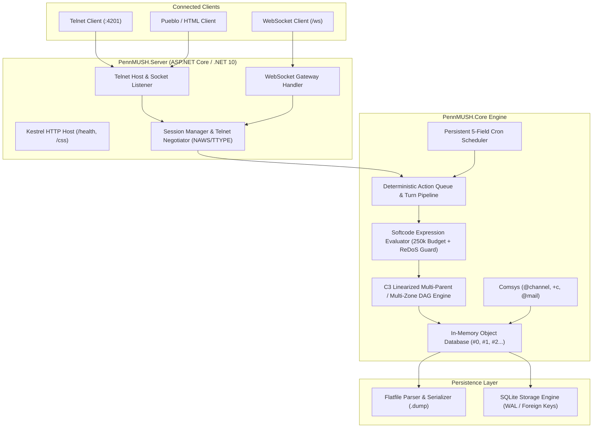

# PennMUSH .NET

A modern, high-performance C# / .NET 10 reimplementation of the **PennMUSH** virtual world engine.

PennMUSH .NET preserves backward compatibility with standard PennMUSH softcode and database flatfiles while replacing legacy single-threaded C constraints with modern asynchronous concurrency, transactional SQLite storage, robust runtime safety guards, and built-in cron scheduling.

---

## 🌟 Key Highlights & Architectural Differences

| Feature | Legacy PennMUSH (C) | PennMUSH .NET (C# 13 / .NET 10) |
| :--- | :--- | :--- |
| **Runtime & Concurrency** | Single-threaded event loop (`select()` / `poll()`) with blocking operations | Fully asynchronous, multi-threaded task pipeline with deterministic command turn slicing |
| **Persistence** | Text `.dump` flatfiles prone to corruption on hard crashes | **Dual persistence:** Transactional SQLite (WAL mode, foreign keys, ACID) alongside PennMUSH `.dump` flatfile parser/serializer |
| **Execution Budget** | 2,500 hard invocation cap (frequently aborts complex softcode) | **250,000 adaptive token budget** with cooperative execution timeouts |
| **Runaway Protection** | Prone to infinite recursion crashes and ReDoS regex freezes | **Active call-trail cycle detection** + **100ms ReDoS timeout** + **queue flood throttle** |
| **Object Inheritance** | Linear search through parents / zones with attribute shadowing quirks | **C3 Linearization (DAG)** for clean multi-parent and multi-zone attribute & lock resolution |
| **Task Scheduling** | Fragile recursive `@wait` loops and external crontab wrappers | **Native 5-field Cron Engine** (`@cron`, `cron_add()`, `cron_list()`) persisted to database |
| **Networking** | Raw Telnet socket with ad-hoc option parsing | **Dual-transport:** Async Telnet listener (`:4201`) + Native WebSocket gateway (`/ws`) |
| **Presentation & HTML** | Text-only or legacy Pueblo custom tags | **TELOPT NAWS & TTYPE negotiation**, direct HTML streaming for modern web/Pueblo clients, and TrueColor/256/16-color ANSI fallback |
| **Web Integration** | Requires external web server / CGI | Embedded ASP.NET Core Kestrel server serving static stylesheets (`/css`), health checks (`/health`), and WebSockets |

---

## 🏛️ Architecture Overview



---

## 🚀 Key Subsystems

### 1. Softcode Evaluator & Runtime Safety
PennMUSH .NET features a complete MUSHcode expression evaluator supporting ~400 standard softcode functions:
- **Adaptive Execution Budget:** 250,000 execution tokens per invocation (100x legacy limits) without risking runaway CPU usage.
- **Cycle & Recursion Protection:** Active `CallTrail` tracking prevents recursive attribute call loops (`A` calling `B` calling `A`) before stack overflow occurs.
- **ReDoS Guard:** Softcode regular expressions enforce a strict 100ms cancellation timeout.
- **Async Softcode Primitives:** Native support for non-blocking operations via `async()`, `parallel_map()`, and `bgtask()`.

### 2. Multi-Parent & Multi-Zone DAG Resolution
Objects support multiple parents (`@parent obj = #p1 #p2`) and multiple zones (`@chzone obj = #z1 #z2`). 
Attribute, lock, and flag lookups use **C3 Linearization** (the same algorithm used by Python and Dylan for method resolution orders), ensuring:
- Deterministic attribute lookup across complex diamond inheritance graphs.
- Prevention of circular inheritance graphs.
- Clear, predictable attribute inheritance without shadowing bugs.

### 3. Native Cron Scheduling Subsystem
No more fragile `@wait 60 = @trigger me/TICK` loops or external crontab wrappers.
- Implements standard 5-field cron expressions: `minute hour dom month dow`.
- In-game administrative command:
  ```mushcode
  @cron/add DailyBackup=0 4 * * * = @dump
  @cron/list
  @cron/delete DailyBackup
  ```
- Softcode functions: `cron_list()`, `cron_add()`, `cron_del()`, `cron_info()`.
- Schedules are durable and saved directly into the database.

### 4. Dual Persistence Layer
- **Flatfile Store:** Imports and exports legacy PennMUSH database files (`mush.dump`), maintaining full compatibility with existing archives and worlds.
- **SQLite Store:** Modern transactional persistence utilizing SQLite in WAL mode with relational tables for objects, attributes, locks, channels, mail, and cron jobs.

### 5. Modern Presentation & Networking
- **Telnet Negotiation:** Full support for `TELOPT_NAWS` (client window resizing) and `TELOPT_TTYPE` (terminal capabilities detection).
- **Rich HTML & Pueblo Support:** Direct raw HTML tags can be streamed to clients reporting Pueblo capability or connected via WebSockets.
- **Color Translation:** Rich HTML colors (`<span style="color: #55ff55">`) automatically translate to 24-bit TrueColor ANSI, 256-color xterm palette, or 16-color ANSI fallbacks based on terminal capabilities.
- **Kestrel Web Server:** Hosts live CSS stylesheets (`/css/classic.css`) referenced by Pueblo clients, and serves health endpoints.

---

## 📁 Repository Structure

```
pennmush-dotnet/
├── PennMUSH.slnx                     # Modern .NET solution file
├── .gitignore                        # Git ignore rules for .NET & SQLite
├── README.md                         # Project documentation
├── PennMUSH.Core/                    # Core virtual world engine
│   ├── Commands/                     # Command dispatchers (@dig, @emit, @cron, etc.)
│   ├── Common/                       # Dbref, core utilities, C3 linearization
│   ├── Communication/                # Channels, mail system, comsys
│   ├── Database/                     # In-memory object model, attribute tree
│   ├── Evaluation/                   # Softcode evaluator, tokenizer, functions
│   ├── Flags/                        # Authoritative flag & power tables
│   ├── Locks/                        # Boolean lock parser and evaluator
│   ├── Negotiation/                  # Telnet protocol negotiation, Pueblo, ANSI
│   ├── Persistence/                  # Flatfile (.dump) and SQLite stores
│   ├── Queue/                        # Deterministic turn queue and async execution
│   └── Scheduling/                   # 5-field Cron parser and scheduler
├── PennMUSH.Server/                  # Host executable
│   ├── Hosting/                      # Telnet server, WebSocket hub, Kestrel host
│   └── wwwroot/css/                  # Embedded stylesheets for web/Pueblo clients
└── PennMUSH.Core.Tests/              # Test suite (128 passing unit & integration tests)
    ├── Commands/
    ├── Evaluation/
    ├── Locks/
    ├── Negotiation/
    ├── Persistence/
    └── Scheduling/
```

---

## 🛠️ Getting Started

### Prerequisites
- [.NET 10 SDK](https://dotnet.microsoft.com/download/dotnet/10.0)

### Building
```bash
dotnet build PennMUSH.slnx
```

### Running Tests
Execute the comprehensive test suite:
```bash
dotnet test PennMUSH.slnx
```

### Running the Server
Launch the unified server:
```bash
dotnet run --project PennMUSH.Server
```

By default:
- **Telnet Listener:** `0.0.0.0:4201`
- **WebSocket Gateway:** `ws://localhost:5000/ws`
- **HTTP Server:** `http://localhost:5000` (Health check at `http://localhost:5000/health`)

---

## 📜 License & Credits

PennMUSH .NET is released under **The Artistic License**, maintaining strict licensing and attribution parity with the parent PennMUSH project.

See [LICENSE](LICENSE) for the full terms of the Artistic License, and [COPYRITE](COPYRITE) for historical copyrights, derivations (TinyMUSH 2.0 / 2.2, TinyMUD), and upstream credits.
